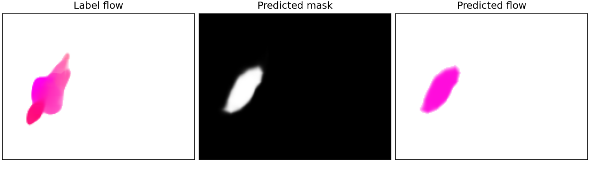
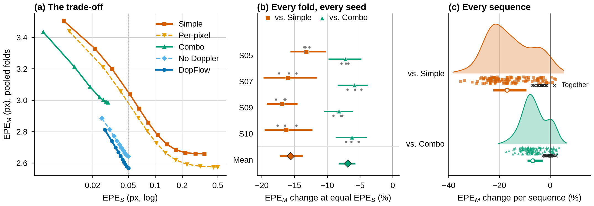

# DopFlow

**Compact factorized image-plane motion estimation from multi-link WiFi**

DopFlow estimates where people move in a camera's image plane, and how fast, from WiFi channel state information (CSI). A camera is needed to create training labels, but not at inference.

Instead of predicting a dense flow field, DopFlow outputs a spatial mask and one velocity:

```text
F = M * (M > tau) * V,  tau = 0.2
```

- **M, where motion occurs:** a 128 x 168 mask from a compact CSI encoder.
- **V, how fast it moves:** one 2-D velocity from multi-link Doppler spectra and CSI features, fused over three windows.

The model has 1.14 M parameters and needs 0.085 GFLOPs in the network.

## Quick start

```bash
git clone https://github.com/baobingzhang/DopFlow.git
cd DopFlow
python -m venv .venv && source .venv/bin/activate
pip install -r requirements.txt
python scripts/demo_inference.py
```

The demo runs the included weights on one real frame. On its first run it downloads three CSI windows and one flow label (about 2.6 MB) from the official WiFlow archive, so it needs internet access. It runs on a GPU if available and otherwise on a CPU.

Expected output (latency depends on your hardware, and the last digit can differ between CPU and GPU):

```text
Sample: subject S05, action A17 (Fast walk), frame 90; device cpu; 1,143,317 parameters
Inference: ... ms from raw CSI to flow, output (2, 128, 168)
Moving-region EPE 3.257 px, static-region EPE 0.009 px, moving pixels 1281
Velocity: predicted (4.74, -5.95) px/frame, label mean (4.60, -3.78) px/frame
```

It also saves `demo_output.png`:



The frame was fixed in advance by a rule (frame 90 of the subject's first Fast-walk sequence), not picked for its result. Subject S05 was held out from the training of these weights. One frame is only a usage example; the results below summarize the evaluation.

## Results

All results use the [WiFlow dataset](https://visinf.github.io/wiflow), four leave-one-subject-out folds (S05, S07, S09, S10) and three seeds. Labels are video-derived pseudo-ground truth. Simple and Combo are WiFlow baselines that we retrained.

| | DopFlow | Simple | Combo |
|---|---:|---:|---:|
| EPE_M at default settings (px) | **2.591** | 2.659 | 2.985 |
| EPE_S at default settings (px) | 0.046 | 0.353 | **0.030** |
| EPE_M change at equal EPE_S | | **-15.6%** | **-6.9%** |
| Velocity direction error | **16.9°** | 22.8° | 22.9° |
| Parameters (M) | **1.14** | 17.90 | 35.81 |
| Network GFLOPs | **0.085** | 21.1 | 42.1 |
| One-thread CPU latency (ms) | **22.3** | 140.9 | 281.4 |

EPE_M and EPE_S are endpoint errors on moving and static pixels. The 95% sequence-bootstrap intervals for the mean gaps at equal EPE_S are [-17.1, -13.9] against Simple and [-8.1, -5.8] against Combo; the Combo level was chosen after inspecting the curves.



### Limitations

- All data come from one room and one camera viewpoint, and four test subjects.
- With two people moving, DopFlow improves on zero prediction by only 8%, and Simple does better at default settings.
- Combo keeps the lower EPE_S at default settings and reaches much lower EPE_S overall.
- Without retraining, losing a receiver leaves DopFlow clearly worse than Simple in two of four cases.
- DopFlow predicts some motion on frames with no motion, so it is not a presence detector.
- A strict fold-by-fold criterion in our analysis plan was not met.

## Repository layout

```text
DopFlow/
├── scripts/
│   ├── demo_inference.py     # Demo on one real frame
│   ├── dopflow_model.py      # Model
│   ├── dopflow_doppler.py    # Doppler spectra and mask inputs from raw CSI
│   ├── dopflow_cache.py      # Per-frame cache
│   ├── dopflow_data.py       # Cache access and subject splits
│   ├── dopflow_train.py      # Training and evaluation after training
│   ├── dopflow_eval.py       # Evaluation of a saved run
│   └── paths.py              # Project root (DOPFLOW_ROOT)
├── weights/
│   └── dopflow_S05_seed0.pth # Trained with S05 and S02 excluded
├── demo/
│   └── sample_manifest.json  # Location and checksums of the demo files
├── assets/                   # README figures
├── LICENSE
└── requirements.txt
```

## Train and evaluate on the full dataset

Full reproduction of one fold needs the 67 GB dataset archive (about 140 GB extracted), about 13 GB for the cache and a GPU. On an RTX 4090, training took about 7 minutes per run.

**1. Get the data.** Download [WiFlow.zip](https://download.visinf.tu-darmstadt.de/data/wiflow/WiFlow.zip) and extract it to `data/`, so that this folder exists:

```text
data/WiFlow/birdviewplus/S05/A17/csi/frame090.pt
data/WiFlow/birdviewplus/S05/A17/flow/frame090.pt
```

**2. Build the cache.**

```bash
python scripts/dopflow_cache.py
```

**3. Train one fold.**

```bash
python scripts/dopflow_train.py --run S05_s0 --stage folds --steps 60000 --seed 0 \
  --train_subj S00,S01,S03,S04,S06,S07,S08,S09,S10 --eval_subjects S05 \
  --vsrc both --dropout 0.2 --lam_f 0.5 --lam_v 1 --tau 0.2 --offs -1,0,1
```

This saves `runs/S05_s0/model.pth` and `results/dopflow/folds/S05_s0.json`.

**4. Evaluate a saved run.**

```bash
python scripts/dopflow_eval.py results/dopflow/folds/S05_s0.json S05 S05_s0_eval.json
```

### Folds

Each fold trains on all subjects except S02 and the held-out subject.

| Held-out subject | `--train_subj` | Paper EPE_M, three-seed mean | Paper EPE_S |
|---|---|---:|---:|
| S05 | `S00,S01,S03,S04,S06,S07,S08,S09,S10` | 3.071 | 0.044 |
| S07 | `S00,S01,S03,S04,S05,S06,S08,S09,S10` | 2.299 | 0.051 |
| S09 | `S00,S01,S03,S04,S05,S06,S07,S08,S10` | 2.569 | 0.041 |
| S10 | `S00,S01,S03,S04,S05,S06,S07,S08,S09` | 2.477 | 0.049 |

The paper uses seeds 0, 1 and 2. Results can vary slightly with hardware and library versions. The included weights give EPE_M 3.082 and EPE_S 0.044 on all of S05.

### Main options

| Option | Paper value | Meaning |
|---|---|---|
| `--vsrc` | `both` | Velocity input: Doppler and CSI features |
| `--tau` | `0.2` | Mask threshold at inference |
| `--offs` | `-1,0,1` | CSI windows relative to frame `i` |
| `--lam_f`, `--lam_v` | `0.5`, `1` | Weights of the flow and velocity losses |
| `--dropout` | `0.2` | Dropout on the velocity sequence |
| `--steps`, `--bs`, `--lr` | `60000`, `32`, `0.001` | Training steps, batch size, learning rate |
| `--doppler` | `1` | `0` removes the Doppler branch |
| `--dec` | `blob` | `pixel` gives a per-pixel decoder for ablation; use with `--lam_f 0 --vsrc dop --tau 0` |

## What is not included

This repository covers DopFlow only. It does not include the dataset, weights for other folds and seeds, the baseline reimplementations, or the scripts for the paper's analyses, tables and figures.

## License

The code is released under the [MIT License](LICENSE). The license does not cover the WiFlow dataset, which is downloaded from its authors. The included weights were trained on that dataset, so its terms may also apply to them.

## Acknowledgments

The dataset and the Simple and Combo baselines come from [WiFlow](https://visinf.github.io/wiflow) by Weigel et al. Please check their project page for the dataset's terms of use.
